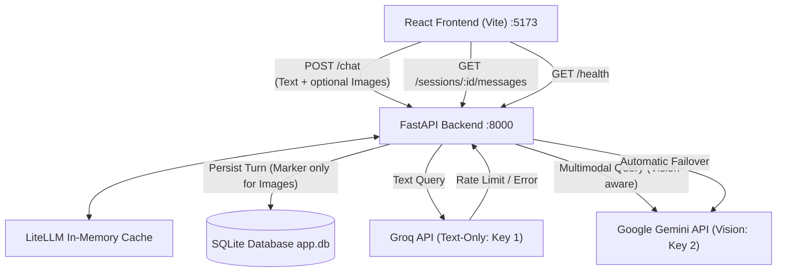

# Production-Ready Resilient LLM Chatbot

A high-performance, fault-tolerant chatbot system built with **FastAPI**, **React (Vite)**, and **LiteLLM**. Designed for production resilience with automated multi-key failover, vision routing, voice input/output, in-memory response caching, token usage tracking, and interactive resilience demo controls.

---

## 🌟 Key Highlights & Graded Features

### 1. Multi-Provider Key Pool & Automatic Failover
- **Resilient Fallback**: Configured with a pool of LLM providers (Primary: Groq `openai/gpt-oss-20b`, Secondary: Google Gemini `gemini-3.5-flash-lite`).
- **Zero Interruption**: If the primary key encounters transient errors (401, 403, 408, 429 rate limit, 5xx server errors), the gateway instantly tries the next key in the pool.
- **Failover Path Replay**: Under any reply that switched keys, an animated chip strip shows the failure sequence: `key_1 ✗` ➔ `key_2 ✓`.
- **Segmented Failover Control Panel**: One-click toggles: `Normal`, `key_1 → 429`, `key_1 → 500`, and `All keys down (*=429)`. The composer glows red while a simulation mode is active.

### 2. 📎 Files & 🖼 Multimodal Vision Routing
- **Three Ways to Attach**: Attach files via the `📎` button, drag & drop directly onto the chat window, or paste an image from your clipboard (`Ctrl+V`).
- **Text & Code File Ingestion**: Reads `.txt`, `.csv`, `.md`, `.py`, `.json`, `.js`, `.ts`, `.html`, `.css`, etc. in the browser and formats them cleanly into the prompt within the 4,000-character budget.
- **Smart Image Downscaling**: Resizes large images on the fly via `<canvas>` to at most 1,024 px on the longest side before sending as base64 data URLs.
- **Vision-Aware Model Routing**: Automatically skips text-only models (like Groq `openai/gpt-oss-20b` or `llama-3.1-8b-instant`) and routes images directly to vision-capable models (like `gemini/gemini-3.5-flash-lite`). Skipping text-only keys does **not** count as a failure (`fallback_attempts: 0`).
- **Lightweight Database Footprint**: Images are never stored directly in the SQLite database; history stores a clean text marker `[N image(s) attached]`.

### 3. 🎤 Voice Input & 🔊 Text-to-Speech
- **Speak Your Message (Dictation)**: Built-in speech recognition via the browser's `SpeechRecognition` API. The microphone button pulses red while listening and automatically transcribes words directly into the input box.
- **Read Replies Aloud**: A `🔊` button on every assistant bubble to speak the answer aloud using `SpeechSynthesis`.
- **Auto-Read Replies**: Optional toggle in Settings to automatically read out every incoming reply.
- **Zero Extra Dependencies**: Uses native browser speech APIs with graceful fallbacks.

### 4. ⚡ Built-in In-Memory Caching & Visual Latency Bar
- **Fast Deduplication**: Cached responses skip network latency completely, dropping response times from ~600ms down to <5ms.
- **Cache-Hit Gold Flash**: Cached responses pulse gold with an illuminated `⚡ LLM_CACHE` badge.
- **Visual Latency Bar**: A speed track under every reply visualizes `latency_ms` (cached queries show a tiny gold sliver; live calls show a full green bar).
- **Live Caching Analytics**: The session stats strip updates in real time showing total replies, cache hit percentage (e.g., `33% cached`), token counts, and comparative latency (`live avg 580 ms vs cache avg 3 ms`).

### 5. Interactive UI Polish & Micro-Interactions
- **Slide-in Bubble Animations**: User messages slide in smoothly from the right; assistant replies glide in from the left.
- **Bouncing Dot Typing Indicator**: Modern 3-dot wave animation while the LLM is thinking.
- **Error Shake & One-Click Retry**: Error bubbles shake gently on 422/503 and provide an instant `Retry` button that resends the prompt.
- **Suggested Starter Chips**: Clickable starter questions on the empty screen for quick one-click testing of cache and failover.
- **Contract Character Counter**: Displays `X / 4,000` under the input box, turning amber at 90% and red over 4,000 characters to reflect the 422 validation rule.
- **Copy Reply Button**: One-click copy icon on assistant messages.
- **Backend Health Beacon**: Live status beacon in the header driven by `GET /health` polling (pulsing green when healthy, red when offline).
- **Accessibility**: Full `@media (prefers-reduced-motion: reduce)` support.

---

## 🛠️ Architecture & Multimodal Flow



---

## 📋 API Contract

All endpoints strictly adhere to the specification contract:

### 1. `GET /health`
Returns service health, configured key count, and cache status:
```json
{
  "status": "ok",
  "keys_configured": 2,
  "cache_enabled": true
}
```

### 2. `POST /chat`
Accepts user message, session ID, and optional base64 images, returning assistant reply and exact execution metadata:
```json
// Request
{
  "session_id": "s-example-123",
  "message": "What is in this picture?",
  "images": ["data:image/jpeg;base64,..."]
}

// Response (HTTP 200)
{
  "session_id": "s-example-123",
  "reply": "This image shows...",
  "metadata": {
    "resolution_source": "LIVE_INFERENCE",
    "model": "gemini/gemini-3.5-flash-lite",
    "latency_ms": 720,
    "input_tokens": 120,
    "output_tokens": 45,
    "key_id": "key_2",
    "fallback_attempts": 0
  }
}
```

### 3. `GET /sessions/{session_id}/messages`
Retrieves chronologically ordered messages and metadata:
```json
{
  "session_id": "s-example-123",
  "messages": [
    { "role": "user", "content": "What is in this picture?\n[1 image(s) attached]" },
    { "role": "assistant", "content": "This image shows...", "metadata": { ... } }
  ]
}
```

---

## 🚀 Running the Project

### Prerequisites
- Python 3.10+
- Node.js 18+ and npm

### 1. Configuration
Create a `.env` file in the project root:
```env
LLM_API_KEYS=your-groq-key,your-gemini-key
LLM_MODEL=groq/openai/gpt-oss-20b
LLM_MODELS=groq/openai/gpt-oss-20b,gemini/gemini-3.5-flash-lite

DATABASE_URL=sqlite:///./app.db
ALLOWED_ORIGINS=http://localhost:3000,http://localhost:5173,http://127.0.0.1:3000,http://127.0.0.1:5173
ENABLE_FAILURE_SIMULATION=true
DEFAULT_SYSTEM_PROMPT=You are a helpful, concise assistant.
VITE_API_URL=http://localhost:8000
```

### 2. Start Backend
```powershell
cd chatbot/backend
python -m uvicorn app.main:app --host 127.0.0.1 --port 8000
```
Backend health check is accessible at `http://127.0.0.1:8000/health`.

### 3. Start Frontend
```powershell
cd chatbot/frontend
npm install
npm run dev -- --host 127.0.0.1 --port 5173
```
Frontend UI will be running at `http://127.0.0.1:5173`.

---

## 🧪 Running Automated Tests

Run the full pytest suite:
```powershell
cd chatbot/backend
python -m pytest -v
```
All **63 test cases** pass across:
- `test_api.py`: Endpoint shape, validation, 422s, CORS
- `test_cache.py`: Exact-cache deduplication, isolation, latency advantage
- `test_failover.py`: Multi-key failover, transient error retry, simulation headers
- `test_images.py`: Vision routing, text-only skipping, SQLite marker storage, 422 on invalid images
- `test_sessions.py`: Multi-turn context history, session isolation, database restarts
- `test_tokens.py`: Token usage reporting, non-cumulative turn counting
